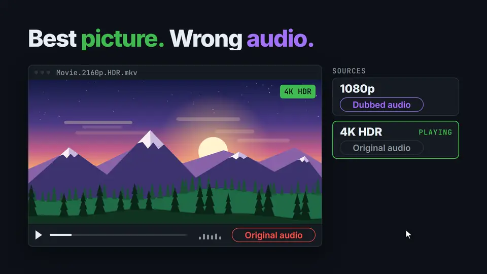

<p align="center"></p>

<p align="center"><b>Any audio on any video.</b> Watch the picture of one source with the sound of another.</p>

<p align="center">
  <a href="https://github.com/joaodutra88/mpv-anyaudio/releases/latest"></a>
  <a href="LICENSE"></a>
</p>

<p align="center"><a href="assets/demo.mp4"></a></p>

The best-looking release of a film is often not the one with the audio you want: the 4K
file has only the original language, and the dub lives in a 1080p file. `anyaudio` is a
small [mpv](https://mpv.io) script that plays the video of one and the audio of the other,
in sync, without downloading or remuxing anything first.

[Português (Brasil)](README.pt-BR.md)

## How it works

| Key | Action | When |
|---|---|---|
| `F6` | **grab**: remember this source | while the source with the audio you want is playing |
| `F7` | **apply**: add that audio here and switch to it | while the source with the video you want is playing |
| `F8` | **clear**: back to this source's own audio | any time after `F7` |

The result of each key is shown on screen (`anyaudio: ...`).

If the sound is early or late, shift it with mpv's audio delay: `Ctrl++` / `Ctrl+-` in mpv,
`F9` / `F10` in Nuvio.

## Install

### mpv, mpv.net and other mpv-based players

Copy `anyaudio.lua` into the `scripts` folder of your mpv config:

- Windows: `%APPDATA%\mpv\scripts\`
- Linux / macOS: `~/.config/mpv/scripts/`

### Stremio

Works on Stremio builds that have a `portable_config` folder next to `stremio.exe`
(tested on a Stremio 5 community build). Copy `anyaudio.lua` into
`portable_config\scripts\` and restart Stremio.

### Nuvio Desktop (Windows, experimental)

Nuvio creates its player with `config=no`, so it never reads mpv scripts or `mpv.conf`.
The `nuvio` folder contains a small `libmpv-2.dll` shim that sits in front of Nuvio's own
libmpv and loads them.

1. Download the release zip and extract it anywhere.
2. Run `nuvio\install.ps1` in PowerShell.
3. Restart Nuvio.

Run `install.ps1` again after every Nuvio update. `nuvio\uninstall.ps1` undoes it.

What the installer does: copies libmpv out of your own Nuvio install into `nuvio\real\`,
writes `nuvio\nuvio-mpv.conf`, and sets the user environment variable
`NUVIO_LIBMPV_PATH`, which Nuvio itself checks first when loading libmpv. Nothing inside
the Nuvio install folder is modified.

Read before installing:

- The shim installs a global keyboard hook so that `F6`..`F10` work, because Nuvio does
  not forward keys to mpv. It only acts while Nuvio is in the foreground with media
  loaded. Some antivirus products flag keyboard hooks.
- A Nuvio update can change how the app loads libmpv and break the shim until this
  project catches up.
- To build the shim yourself instead of using the release: `nuvio\make.cmd` from an
  "x64 Native Tools Command Prompt for VS 2022".

`nuvio\nuvio-mpv.conf` takes any mpv option (`name=value`, one per line), so it is also
the way to get your own mpv settings into Nuvio. `nuvio\input.conf` takes key bindings.

## Limits

- **Same cut.** Both sources must be the same version of the film or episode. A fixed
  offset (an extra logo at the start) is fixable with audio delay; a different edit is not.
- **Same frame rate.** 23.976 fps against 25 fps drifts further apart every minute.
- **Bandwidth.** The player streams both sources at once.
- **Per file.** The added audio belongs to the file being played: press `F7` again on
  the next episode, after `F6` on its matching source.
- **Expiring links.** A grabbed streaming link can expire before you apply it.

## Privacy

`F6` writes the address of the current source, in plain text, to `mpv-anyaudio.txt` in
your temp folder. Streaming links can carry account tokens: do not share that file.
Change the location with `--script-opts=anyaudio-state_file=<path>`.

## Optional add-ons

[extras](extras/README.md) has copy-paste snippets for audio normalization (loudnorm) and
Anime4K upscaling, with credit to their authors.

## Tests

```
python tests/test_anyaudio.py <path to libmpv-2.dll or libmpv.so>
```

Runs grab / apply / clear inside a headless libmpv started with `config=no`. Needs
`ffmpeg` on PATH.

## Roadmap

- README in more languages
- Remember which audio source goes with which series
- Linux and macOS support for Nuvio

## Contributing

Issues and pull requests are welcome, especially reports of which players and builds it
works on. See [CONTRIBUTING.md](CONTRIBUTING.md) for what to include in a report and how
to send a change.

## Credits

- [mpv](https://mpv.io), which does all the real work
- [Nuvio](https://github.com/NuvioMedia/NuvioDesktop) and [Stremio](https://www.stremio.com)

## License

[MIT](LICENSE)
