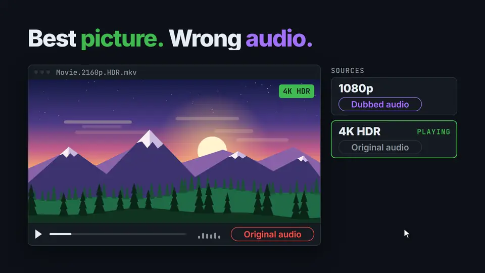

<p align="center"></p>

<p align="center"><b>Qualquer áudio em qualquer vídeo.</b> Assista à imagem de uma fonte com o som de outra.</p>

<p align="center">
  <a href="https://github.com/joaodutra88/mpv-anyaudio/releases/latest"></a>
  <a href="LICENSE"></a>
</p>

<p align="center"><a href="assets/demo.mp4"></a></p>

A versão mais bonita de um filme muitas vezes não é a que tem o áudio que você quer: o
arquivo 4K só tem o idioma original, e a dublagem está num arquivo 1080p. O `anyaudio` é
um script pequeno para o [mpv](https://mpv.io) que toca o vídeo de um e o áudio do outro,
em sincronia, sem baixar nem remuxar nada antes.

[English](README.md)

## Como funciona

| Tecla | Ação | Quando |
|---|---|---|
| `F6` | **grab**: guarda esta fonte | com a fonte do áudio que você quer tocando |
| `F7` | **apply**: adiciona aquele áudio aqui e troca para ele | com a fonte do vídeo que você quer tocando |
| `F8` | **clear**: volta ao áudio da própria fonte | a qualquer momento depois do `F7` |
| `Ctrl+F7` | **mkvmerge**: copia o comando que salva este resultado num arquivo | no mpv, depois do `F7`, com as duas fontes em arquivos no seu disco |

O resultado de cada tecla aparece na tela (`anyaudio: ...`), em inglês.

Se o som estiver adiantado ou atrasado, ajuste com o atraso de áudio do mpv: `Ctrl++` /
`Ctrl+-` no mpv, `F9` / `F10` no Nuvio.

## Instalação

### mpv, mpv.net e outros players baseados em mpv

Copie o `anyaudio.lua` para a pasta `scripts` da configuração do mpv:

- Windows: `%APPDATA%\mpv\scripts\`
- Linux / macOS: `~/.config/mpv/scripts/`

### Stremio

Funciona nas versões do Stremio que têm a pasta `portable_config` ao lado do
`stremio.exe` (testado numa build da comunidade do Stremio 5). Copie o `anyaudio.lua`
para `portable_config\scripts\` e reinicie o Stremio.

### Nuvio Desktop (Windows, experimental)

O Nuvio cria o player com `config=no`, então nunca lê scripts de mpv nem `mpv.conf`. A
pasta `nuvio` traz um shim pequeno de `libmpv-2.dll`, que fica na frente da libmpv do
próprio Nuvio e carrega essas coisas.

1. Baixe o zip da release e extraia em qualquer pasta.
2. Rode `nuvio\install.ps1` no PowerShell.
3. Reinicie o Nuvio.

Rode o `install.ps1` de novo depois de cada atualização do Nuvio. O
`nuvio\uninstall.ps1` desfaz a instalação.

O que o instalador faz: copia a libmpv da sua própria instalação do Nuvio para
`nuvio\real\`, cria o `nuvio\nuvio-mpv.conf` e define a variável de ambiente de usuário
`NUVIO_LIBMPV_PATH`, que o próprio Nuvio consulta primeiro ao carregar a libmpv. Nada
dentro da pasta de instalação do Nuvio é alterado.

Leia antes de instalar:

- O shim instala um hook global de teclado para que `F6`..`F10` funcionem, porque o
  Nuvio não repassa teclas ao mpv. Ele só age com o Nuvio em primeiro plano e com mídia
  carregada. Alguns antivírus sinalizam hooks de teclado.
- Uma atualização do Nuvio pode mudar a forma como o app carrega a libmpv e quebrar o
  shim até este projeto se ajustar.
- Para compilar o shim em vez de usar a release: `nuvio\make.cmd` a partir de um
  "x64 Native Tools Command Prompt for VS 2022".

O `nuvio\nuvio-mpv.conf` aceita qualquer opção do mpv (`nome=valor`, uma por linha),
então também é o caminho para levar as suas configurações de mpv para o Nuvio. O
`nuvio\input.conf` aceita atalhos de teclado.

### Atualizando

Versões novas saem como [releases](https://github.com/joaodutra88/mpv-anyaudio/releases).
Para ser avisado, use **Watch → Custom → Releases** no topo desta página.

- mpv e Stremio: troque o `anyaudio.lua` pelo da release nova.
- Nuvio: feche o Nuvio, copie os arquivos da release nova por cima da sua pasta atual e
  rode o `nuvio\install.ps1` de novo. O seu `nuvio\nuvio-mpv.conf` é mantido; o
  `nuvio\input.conf` é substituído, então faça uma cópia antes se você o editou.

## Limites

- **Mesmo corte.** As duas fontes precisam ser a mesma versão do filme ou episódio. Um
  deslocamento fixo (um logo a mais no começo) se corrige com o atraso de áudio; uma
  edição diferente não.
- **Mesmo frame rate.** 23,976 fps contra 25 fps se afasta mais a cada minuto.
- **Banda.** O player transmite as duas fontes ao mesmo tempo.
- **Por arquivo.** O áudio adicionado pertence ao arquivo em reprodução: aperte `F7` de
  novo no próximo episódio, depois do `F6` na fonte correspondente.
- **Links que expiram.** Um link de streaming guardado pode expirar antes de ser aplicado.

## anyaudio, `--audio-file` ou mkvmerge?

Os três colocam o áudio de uma fonte no vídeo de outra. Escolha pelo lugar onde estão as
suas fontes:

| | anyaudio | `--audio-file` do mpv | mkvmerge / MKVToolNix |
|---|---|---|---|
| Fontes | o que o player estiver tocando, streams incluídos | caminhos ou URLs que você digita | arquivos no seu disco |
| Dentro do Stremio / Nuvio | sim | não | não |
| Baixar ou remuxar antes | não | não | sim, os dois arquivos inteiros |
| Resultado | esta reprodução | esta reprodução | um arquivo novo que toca em qualquer player |

O anyaudio faz o mesmo que o `--audio-file` (o comando `audio-add` do mpv); o que ele
acrescenta é escolher a fonte de dentro do player, onde o endereço do stream normalmente
fica escondido. Se os dois arquivos estão no seu disco e você quer guardar o resultado, o
mkvmerge é a ferramenta melhor: sem banda extra e nada para preparar na próxima vez.
Quando um par tocar bem, o `Ctrl+F7` monta o comando `mkvmerge` pronto: a dublagem, com o
seu atraso de áudio, vira a faixa padrão do `<nome do vídeo>.anyaudio.mkv`, ao lado do
vídeo. No Windows (mpv 0.40 ou mais novo) ele vai para a área de transferência; nos outros
casos aparece no terminal. Rode onde o `mkvmerge` estiver no PATH (o instalador do
MKVToolNix para Windows não o coloca lá).

## Privacidade

O `F6` grava o endereço da fonte atual, em texto puro, no arquivo `mpv-anyaudio.txt` da
sua pasta temporária. Links de streaming podem carregar tokens de conta: não compartilhe
esse arquivo. Mude o local com `--script-opts=anyaudio-state_file=<caminho>`.

## Complementos opcionais

Em [extras](extras/README.md) há trechos prontos para normalização de áudio (loudnorm) e
upscaling com Anime4K, com crédito aos autores.

## Testes

```
python tests/test_anyaudio.py <caminho da libmpv-2.dll ou libmpv.so>
```

Executa grab / apply / mkvmerge / clear dentro de uma libmpv sem janela, iniciada com
`config=no`. Precisa do `ffmpeg` no PATH. Com o `mkvmerge` no PATH, também roda o comando
gerado e confere o arquivo que ele cria.

## Roadmap

- README em mais idiomas
- Lembrar qual fonte de áudio combina com qual série
- Suporte ao Nuvio no Linux e no macOS

## Contribuindo

Issues e pull requests são bem-vindos, principalmente relatos de em quais players e
versões funciona. O [CONTRIBUTING.md](CONTRIBUTING.md) (em inglês) explica o que incluir
num relato e como enviar uma mudança.

## Créditos

- [mpv](https://mpv.io), que faz todo o trabalho de verdade
- [Nuvio](https://github.com/NuvioMedia/NuvioDesktop) e [Stremio](https://www.stremio.com)

## Licença

[MIT](LICENSE)
